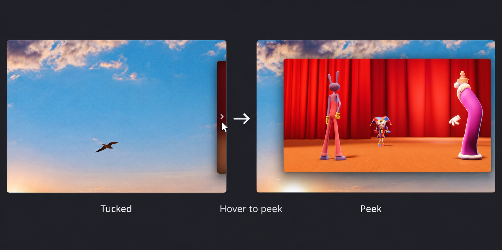
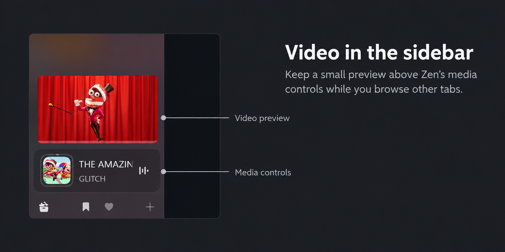

<div align="center">


# PiP Tuck Away

A Sine mod for Zen's picture-in-picture player.


[](https://github.com/apoapostolov/Zen-PiP-Tuck-Away/releases/tag/v1.0.1)
[](https://github.com/apoapostolov/Zen-PiP-Tuck-Away/releases/tag/v1.0.1)
[](LICENSE)

</div>

Right-click the player to tuck it into a screen edge. The video keeps playing,
with a narrow strip left on screen. Right-click again to bring it back.



## What it does

- Right-click or press `Ctrl+Alt+T` to tuck and restore. You can turn either
  control off. The shortcut works while Zen or the player has focus.
- Use the arrow button if you'd rather click a control. Right-click it to pick
  an edge, or turn off **Tuck Control Overlay** to hide it.
- Drag the player partly past an edge, then move the pointer away to tuck it
  there. Pull the strip back onto the screen to leave the player visible.
  **Tuck when dragged past the edge** lets you switch this off.
- Leave **Tuck Direction** on **Smart** to use the player's position, or choose
  a fixed edge. **Tuck width** gives you a 24, 48, or 72px strip. The frosted
  effect is on by default; turn it off to see the video clearly in the strip.
- Enable **Peek while hovering the tucked strip** for a quick look. Hover to
  reveal the video, then move away to tuck it again. It's off by default.
- Keep **Default PiP size** and **Default PiP location** on **Remember Last**,
  or choose a fixed size and opening position. A fixed location opens the
  player tucked there. YouTube moving to the next video keeps the player's place.
- Enable **Auto tuck on PiP switch** to open new players tucked away. It's off
  by default.

Works with [Zia](https://github.com/z1n-k/zia), too. This mod takes over its tuck
controls and removes its minimize button.

## A few extras

- Show the video in Zen's sidebar while browsing other tabs, with play/pause
  and a pop-out button. Click the preview to play or pause, double-click it to
  jump to the video's own tab. **Integrate in Sidebar Media Controls** is
  experimental and on by default. **Sidebar preview frame rate** offers 15, 30,
  or 60 fps, with 30 as the default. Protected video uses the floating player.

  

- A tab that is still **New Tab**, or any `about:newtab`, `about:home` or
  `about:blank` page, is left out of both: nothing from it appears in the
  sidebar, and no player opens for it.

- Enable **Pop the player out when leaving Zen** to get a floating player when
  you switch apps from the video's tab. It's off by default.
- Turn on **Write diagnostic logs** when tracking down a bug. Logging is off
  by default; [contributing](CONTRIBUTING.md) explains where to find the log.

## Install

You'll need Zen Browser with Sine installed. Paste this URL into Sine's mod
installer:

```text
https://github.com/apoapostolov/Zen-PiP-Tuck-Away
```

Restart Zen, then open a video in picture-in-picture.

[All settings](docs/settings.md) · [Changelog](CHANGELOG.md) ·
[Reporting bugs](CONTRIBUTING.md)

Inspired by Zia. [Credits](CREDITS.md) · [MIT license](LICENSE).
